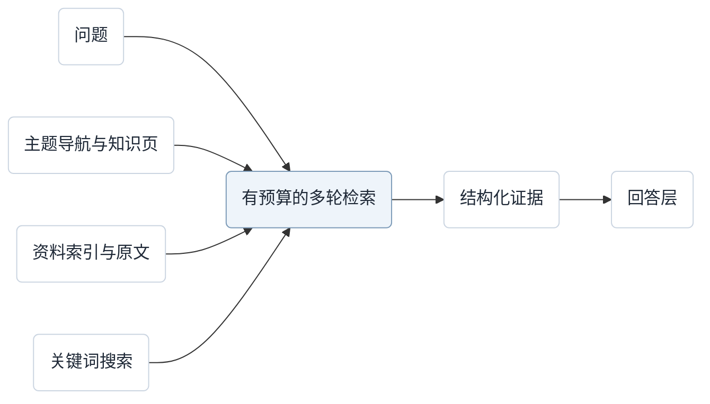

> 更新（2026-10-26）：配置边界由 [ADR-0010](../adr/0010-independent-knowledge-themes.md) 替代：一个 Vault 可有多个独立目标、收录范围和结果的主题。下文初版中的全库共享目标按主题理解。

# 基于结构导航的知识库：第一版需求

确认日期：2026-10-24。状态：第一版需求边界已由用户确认。

本文作为知识生成、持续更新与证据召回的需求基线。已确认的规则列于正文，尚未确定的细节单独列于末尾，后续技术设计以此基线继续细化。

## 目标与范围

借鉴 PageIndex 的结构导航思路，在 Folyn 中支持知识生成、持续更新与证据召回。一个 Vault 对应一个知识库，共享目标、资料、知识页与检索范围。

用户声明知识库目标，AI 据此从资料中发现相关主题，不要求用户预设完整目录。第一版直接支持 Markdown 与纯文本；网页、会话等先保存为正文文件再收录。

## 内容与导航

| 概念 | 职责 |
| --- | --- |
| 原始资料 | 保留来源内容，承载知识依据 |
| 资料索引 | 描述单份资料的结构、摘要和原文位置 |
| 主题知识页 | 整理一份或多份资料，由用户与 AI 共同维护 |
| 主题导航 | 在全库层面关联主题、知识页与相关资料 |

全库主题导航与单份资料的结构索引分开，同一份资料可以关联多个主题。资料索引优先采用已有章节，对无标题或过长内容允许模型补充语义分层。补充分层不改原文，每个节点必须对应真实、可核验的原文范围。

## 生成与增量更新

用户明确选择资料文件或目录，形成收录范围；范围内的新增、修改自动触发处理。生成的知识页不循环作为原始资料收录。

资料变化后更新该资料的索引，通过引用依赖和主题导航、关键词寻找更新候选，再分析实际影响。新资料尚未被引用，也可能补充或推翻已有结论，因此不能只沿引用依赖分析。

| 变化或操作 | 已确认的处理边界 |
| --- | --- |
| 新建知识页、补充新内容 | 可以自动写入 |
| 重复佐证 | 补充已有结论的来源引用，不重复生成正文 |
| 改写、删除已有正文 | 用户确认后应用 |
| 发现观点冲突 | 用户确认后应用对应变更 |
| 用户修改带引用的结论 | 保留正文与来源关联，标记引用待核验并重新检查 |
| 核验发现原文不支持新说法 | 提示问题，保留正文；改写仍须确认 |
| 用户手动删除内容 | 记录删除意图，不自动恢复；新证据可形成待确认的恢复建议 |

“引用待核验”描述证据关联状态；“修订待审阅”描述等待用户确认的正文变更，二者区分。

新增内容按知识内容组织：重复佐证补充引用，新事实添加到合适章节，修订与冲突进入审阅。不按每份资料逐次追加更新小节。

模型负责理解资料、生成结构化内容和提出变更，不直接修改知识页、引用或索引文件。程序校验原文定位、目标文件版本、操作权限和审阅要求，再自动新增或创建待审阅修订；不能覆盖用户已经编辑的新版本。

人工删除意图也以文件保存并随 Vault 携带，后续生成不能仅因内容在当前页面中缺失，就将同一结论作为新内容自动补回。

批量导入与后台更新按单份资料或单个知识页分项发布，不等待整批完成。只有内容、引用与版本完整一致后才用于检索；更新中的内容使用上个完整版本并标注状态，未完成的正文、引用或索引不对检索发布。

## 证据与持久化

AI 根据资料生成的重要段落或独立结论，分别关联原文版本与具体位置。保留最新原文与所有曾被引用的原文版本，不要求保存从未被引用的中间版本。

即使来源后来修改或删除，历史引用仍可核对。历史原文证据及引用关系随 Vault 携带，复制到另一台电脑后仍须完整可查。

来源被删除或移出收录范围后，停止跟踪，保留已有知识与历史引用，并在检索证据中标记来源已移除。不因来源被移除就自动提出知识撤回建议；资料整理与知识撤回应分别表达。

展示出处、引用核验结果、冲突与待更新状态，不自动将这些信息汇总为结论置信度，也不由模型综合评分。引用核验检查原文是否支持关联说法，与独立判定事实可靠性区分。

文件作为知识库真源：主题知识页为普通 Markdown，引用关系、历史原文和审阅记录也以文件保存。关键词索引和缓存可以重建。具体目录、文件格式与写入一致性机制尚待确定。

原始资料与主题知识页使用不随重命名或移动而变化的稳定标识。引用关联标识与具体版本，路径仅记录当前位置；标识与路径映射也随 Vault 携带。

Folyn 现有的机器本地编辑历史与可携带的知识证据具有不同的保留要求，不能直接用前者的生命周期代替后者。

## 检索与回答

采用结构导航与关键词搜索共同召回，不引入向量检索。检索层返回结构化证据，回答层负责组织最终答案。

模型可以依据已读证据继续选择搜索词或目录分支，程序限制检索轮数与读取量。默认检索时间上限为 10 秒，不包括建库及最终答案生成；达到限制时返回已有证据与未解决的缺口。

检索证据包含相关知识页或原文片段、来源、版本、具体位置，以及已知的冲突或待更新状态。知识页修订待审阅时，问答仍可使用已收录原文，说明新旧内容的版本、适用条件或观点差异。资料较新本身不构成判定结论正确的依据。

## 验收

第一版按单 Vault 1,000 份资料验收，覆盖短笔记与长文档；文件数量不设置硬上限，超过基准规模后的表现由测试确认。

检索质量以证据是否足以支持回答为核心。固定问题预先标注可接受的支持证据，分别检查必要证据覆盖、来源版本与位置，以及冲突、待核验状态；同时检查 10 秒时间预算。

场景覆盖事实定位、跨资料综合、新旧观点冲突及资料中没有答案的情况。具体质量门槛尚待确定。

## 待定与后续设计

以下事项尚未确定，不作为已确认的具体实现方案。

- 去重与冲突的具体判定。
- 整页删除、人工删除意图的具体识别，以及恢复建议的去重规则。
- 稳定标识及移动的具体识别规则、段落定位、引用和审阅记录的具体文件格式。
- 分项发布的具体机制，以及文件被同时编辑、任务中断或重试时的写入一致性与重复处理控制。
- 检索入口调度、轮数与读取量预算、提前停止判定及搜索实现。
- 验收样本、具体质量门槛，以及用于验证预算的模型与运行环境。

## 决策与术语

- [术语表](../../CONTEXT.md)
- [内容分层、收录与索引组织](../adr/0005-knowledge-sources-index-and-topic-pages.md)
- [共同维护、审阅与检索边界](../adr/0006-topic-pages-human-ai-coauthoring.md)
- [引用粒度、版本保留与核验](../adr/0007-retain-cited-source-versions.md)
- [召回机制与验收](../adr/0008-structure-navigation-and-keyword-retrieval.md)
- [文件真源](../adr/0009-knowledge-files-as-source-of-truth.md)
